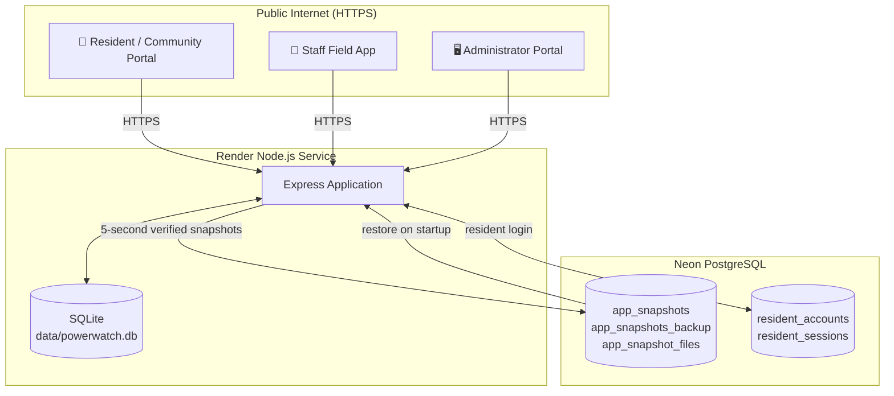

# Valencia PowerWatch: Complete Deployment & Operations Manual
**Community Power Interruption Reporting, Verification, and Information Management System**
*Valencia City, Bukidnon*

---

## 1. Executive Summary & Live Access Links

Valencia PowerWatch is a centralized, real-time power outage monitoring and verification platform designed for Valencia City, Bukidnon. It connects residents reporting local outages directly with utility administrators and emergency dispatchers.

### 🌐 Portal Links
Render is the official, stable online deployment:

* **🖥️ Admin Portal (Desktop / Web)**
  * Online (Internet): <https://valencia-powerwatch.onrender.com/admin>
  * Local: <http://localhost:4000/admin>
* **📱 User / Community Portal (Mobile / PWA)**
  * Online (Internet): <https://valencia-powerwatch.onrender.com/community>
  * Local: <http://localhost:4000/community>
* **🦺 Staff Field App (Mobile / installable PWA)**
  * Online (Internet): <https://valencia-powerwatch.onrender.com/staff>
  * Local: <http://localhost:4000/staff>
* **📲 Install / QR Code Page**
  * Online (Internet): <https://valencia-powerwatch.onrender.com/install>
* **🩺 API Health Check**
  * Online (Internet): <https://valencia-powerwatch.onrender.com/api/health>
  * Local: <http://localhost:4000/api/health>

The Cloudflare Tunnel started by `start-public-online.bat` is temporary. Its link changes when the tunnel restarts; use the Render links above as the permanent public addresses.

### Database, Neon persistence, and the 24-table note
Production runs on the Render free plan without a persistent disk. SQLite remains the operational database for reports, incidents, users, barangays, audit logs, and settings. Neon PostgreSQL stores compressed SQLite snapshots and uploaded files, and also stores resident accounts and resident sessions. Snapshots are uploaded about every 5 seconds when data changes, with a rolling backup copy. On startup, the latest verified snapshot is restored before SQLite opens.

The normalized Neon domain schema contains 35 application tables (24 core and 11 supporting), in addition to the snapshot and resident-auth tables. The current application workflows still use SQLite for operational report, incident, staff, and admin data; the normalized schema is not yet the active CRUD store for those modules. See [DATABASE_RELATIONSHIPS.md](DATABASE_RELATIONSHIPS.md) for the verified schema and [DATABASE_DESIGN_MAPPING.md](DATABASE_DESIGN_MAPPING.md) for the migration mapping and safeguards.

Configure `DATABASE_URL` as a Render secret and set `POWERWATCH_SNAPSHOT_ENABLED=true` and `PERSISTENT_AUTH_REQUIRED=true`. Requiring persistent authentication prevents resident registration or login from silently falling back to Render's ephemeral SQLite if the Neon connection string is missing. The runtime continues to accept `NEON_DATABASE_URL` as a backward-compatible alias; when both are set, `DATABASE_URL` takes precedence. Never commit or share either connection string. When Neon is reachable, `/api/health` reports `storage: neon+sqlite` and exposes snapshot status under `persistence`; `persistence.enabled` indicates whether snapshot persistence is enabled, not whether a database query has succeeded. If Neon is temporarily unreachable, the app continues with local SQLite and retries snapshot uploads; resident login may be unavailable until Neon returns because resident authentication lives there. Admin/staff SQLite logins continue to work. To migrate an exported SQLite backup into Neon resident accounts, run `npm run migrate:resident-accounts -- <path-to-backup.db>` in an environment with `DATABASE_URL` or `NEON_DATABASE_URL` configured securely. The importer reads the backup read-only and never prints account details or password hashes.

### Staff Field App setup
1. In User Management, create an account with the **System Personnel** role.
2. In Admin Portal → Repair & Dispatch, create a **Response Team** (this is separate from the staff login account), then open **Manage Staff Team Access** and assign the personnel account to that team and the barangays it will cover.
3. Verify a resident report and dispatch an available response team that has an active staff member assigned to both the team and the report's barangay. Only personnel assigned to that team can view its work orders and evidence in the Staff App.
4. Open `/staff` on the staff member's phone and sign in with the Admin-created account. On compatible Android browsers, use **Install**; on iOS Safari, use **Share → Add to Home Screen**.
5. Staff acknowledge, navigate to, inspect, and repair assigned incidents; they can post field notes and JPG/PNG/WebP photos (up to 8 MB). After staff marks work complete, Admin reviews the response under **Awaiting Review** and confirms resolution.

---

## 2. Test Accounts

The earlier demo accounts were removed from production. Do not use credentials from older drafts.

- **Residents:** create an account through `/community` → Register.
- **Staff / Utility / Administrator:** accounts are provisioned by an administrator; production credentials are not documented in this repository.
- Never commit real account passwords, `data/powerwatch.db`, or `.env`.

---

## 3. End-to-End System Architecture

The optional Cloudflare Tunnel/local host workflow is for local demonstrations; Render is the official public deployment.

### Key Integration Principles:
1. **SQLite is operational; Neon is durable:** every report, verification, incident update, notification, and audit log writes to SQLite. Neon receives a compressed snapshot of the whole SQLite database and the uploaded files.
2. **Instant Admin Visibility:** reports and incident updates appear in the Admin Portal from the same SQLite data used by the community portal.
3. **Role-Based Security:** resident, personnel, administrator, and utility roles are enforced by `requireRole`; residents cannot use the Admin Portal.
4. **Resident authentication is mirrored:** resident login records live in Neon and are mirrored into SQLite for report ownership and admin pages.

---

## 4. Step-by-Step Operations Guide

### A. Resident / Community User Walkthrough
1. **Open Portal:** Navigate to `/community` on any phone browser.
2. **Account Registration / Login:**
   - Click **Register** to create a personal account (Name, Contact Number, Barangay, Email, Password).
   - Or log in with an existing resident account you created.
3. **Submitting a Power Outage Report:**
   - Tap **"Report Outage"**.
   - Review your Barangay (the GPS lookup may suggest one when OpenStreetMap can match the point to an active Valencia barangay).
   - Tap **Use current location (GPS)** and allow location permission, or tap/drag the marker to place it manually. The map pin and GPS accuracy are shown on the form.
   - Review and confirm both the pin and barangay before continuing. If the lookup is unavailable or cannot identify a barangay, no barangay is guessed; select an active barangay manually and confirm it. A result differing from your registered barangay is shown for your choice.
   - GPS is available only in a secure browser context (HTTPS or localhost) and with device location services enabled. The reverse lookup requires an internet connection. OpenStreetMap labels are not an official cadastral boundary determination; use the manual selection or adjust the pin if the returned label is wrong.
   - Choose outage type (Complete Blackout, Partial Voltage/Flicker, Line Down/Transformer Spark).
   - Optional: Attach a photo or notes.
   - Tap **"Submit Report"**.
4. **Connectivity:** Report submission requires an active internet connection. If the connection drops, reconnect before submitting; reports are not currently saved to an offline queue.
5. **Responder location:** Confirmed coordinates, barangay, and location-source details are stored with the report and shown to authorized Admin and assigned Staff users for triage and dispatch.

### B. Administrator Walkthrough
1. **Login:** Navigate to `/admin` and enter administrator credentials.
2. **Real-time Incident Monitoring:**
   - View incoming reports on the live dispatch board.
   - Filter by Barangay, status (Pending, Verified, Dispatched, Resolved), or severity.
3. **Outage Heatmap & Smart Clustering:**
   - Open the **GIS Map** tab.
   - Toggle the **Heatmap Layer** to see outage density across Valencia City.
   - Use **Cluster Analysis** to detect transformer-level or feeder-level multi-household blackouts.
4. **Broadcast Emergency Advisories:**
   - Post scheduled maintenance announcements or emergency typhoon advisories that immediately appear on all resident phones.
5. **Printable Incident Reports:**
   - Click **"Generate Official Incident Report"** to export printable, audit-ready PDF documents for utility records and city hall archives.

---

## 5. Maintenance & Startup Procedures

If the computer is restarted or turned off, follow these simple steps:

### 1-Click Startup:
1. Open the project folder on your computer.
2. Double-click **`start-public-online.bat`**.
3. A console window will open, verify the local backend, connect to Cloudflare, print the new public HTTPS link, copy it to your clipboard, and automatically launch Google Chrome!
4. Keep the black console window open while using or demonstrating the system.

---

## 6. Security notes

- The live root static mount was removed; `/data`, `/server`, `/package.json`, and `/render.yaml` must return 404. `GET /data/powerwatch.db` returning 200 is a data breach.
- Do not commit `data/powerwatch.db`, `.env`, or any database backup. `data/*.db` is ignored. The GitHub repository is private; old commits and branches still contain the database, so purge them before making the repository public again.
- The database was publicly downloadable before the static fix. The real admin and resident passwords were rotated, sessions were invalidated, and both the latest and rolling backup snapshots verify only the new hashes. Share new credentials privately and change them after login.
- Evidence photos and profile photos are protected by the authenticated `/uploads/:filename` route. Profile photos are limited to the owner, administrators, and utility users. Only announcement images remain public.
- Session cookies are `HttpOnly` and `SameSite=Lax`, with `Secure` set on HTTPS. Raw session tokens are never stored in SQLite or Neon; only SHA-256 hashes are stored.
- Production uses the least-privilege Neon role `powerwatch_app_mvjwen4u`: it can connect and read/write the five application tables, but cannot create databases, roles, or tables. Use `neondb_owner` only for controlled schema provisioning or snapshot recovery. Runtime DDL is skipped when the tables already exist.
- The built-in administrator can change their own password from the authenticated profile screen. Staff-side reset, role, status, delete, admin recovery, and forgot-password flows remain blocked for that account.
- `server/middleware/auth.js` contains built-in admin identifiers. Keep the repository private, or move those identifiers to Render environment variables.
- See [DATABASE_ARCHITECTURE.md](DATABASE_ARCHITECTURE.md) for the current Neon table list, credential-rotation procedure, verification commands, and deployment limits; see [DATABASE_DESIGN_MAPPING.md](DATABASE_DESIGN_MAPPING.md) for the 24-table gap and development-branch migration plan.
